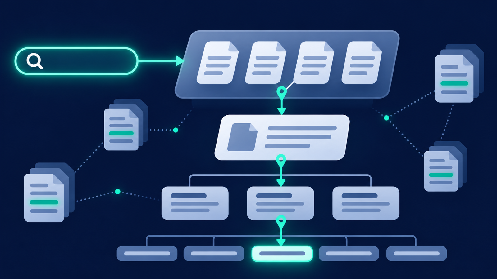

<h1 align="center">pointy-rag</h1>

<p align="center"><b>Search your documents by summary first, then drill down to the exact passage.</b></p>
<p align="center">PDF/EPUB ingestion, Voyage AI embeddings, pgvector search, and an optional Apache AGE knowledge graph, all from one CLI.</p>

<p align="center">
  
  
  <a href="https://github.com/scalefreegan/hybrid-rag/actions/workflows/ci.yml"></a>
</p>

<p align="center">
  
  <br>
  <sub><i>A query lands on a high-level summary, then drills down through sections to the exact passage.</i></sub>
</p>
<!-- TODO: generate docs/hero.png from docs/hero-image-prompt.md -->

## Features

- **Pointer-based search.** Results point into a 4-level disclosure hierarchy (library catalog, document index, section summary, detailed passage) instead of returning flat chunks. Start broad, `drill` when you need detail.
- **PDF and EPUB ingestion.** Converts to markdown, chunks with heading awareness and overlap, and embeds with Voyage AI (`voyage-4-lite`, 1024-dim) into PostgreSQL/pgvector.
- **Agent-built summaries.** Section, document, and library summaries are generated by a headless Claude Code agent. Without it, `--no-agent` falls back to library-based extraction (no hierarchy).
- **Optional knowledge graph.** Apache AGE links similar content across documents (`SIMILAR_TO`) alongside the hierarchy (`CONTAINS`).
- **llms.txt-style output.** `graph-search` and `explore` assemble context for AI agents, including a three-layer package of overview, navigational TOC, and per-node content.
- **Ships a Claude Code skill** so an agent can drive the CLI for you.

## How it works

```
PDF/EPUB
  │
  ▼
converter ──► markdown
  │
  ├──► chunker ──► embed (Voyage AI) ──► chunks table (pgvector)
  │
  └──► disclosure hierarchy (Claude agent)
         │
         ├── L0: library_catalog    (1 per library)
         ├── L1: resource_index     (1 per document)
         ├── L2: section_summary    (N per document)
         └── L3: detailed_passage   (N per document)
                   │
                   ▼
              pointer_mapper ──► chunks linked to disclosure docs
                                    │
                                    ▼
                              search ──► pointer-based results ──► drill navigation
                                    │
                                    ▼ (optional, if KG enabled)
                              knowledge graph (Apache AGE)
                                ├── CONTAINS edges (hierarchy)
                                ├── SIMILAR_TO edges (cross-doc)
                                ├── graph-search ──► llms.txt reference doc
                                └── explore ──► 3-layer package (overview + llms.txt + contents/)
```

### Module map

| Module | Role |
|--------|------|
| `cli.py` | Typer CLI entry point |
| `config.py` | Settings from `.env` / environment |
| `converter.py` | PDF/EPUB to markdown (agent or fallback) |
| `chunker.py` | Markdown-aware text chunking with overlap |
| `embeddings.py` | Voyage AI embedding client (voyage-4-lite, 1024-dim) |
| `db.py` | PostgreSQL/pgvector schema, CRUD, connection management |
| `models.py` | Pydantic data models (Document, DisclosureDoc, Chunk, SearchResult, GraphSearchResult, ExploreResult) |
| `disclosure.py` | 4-level disclosure hierarchy generator |
| `claude_agent.py` | Headless Claude Code subprocess wrapper |
| `pointer_mapper.py` | Maps text chunks to disclosure docs by heading/Jaccard similarity |
| `ingest.py` | End-to-end ingestion pipeline (with optional KG population) |
| `search.py` | Vector search with disclosure pointers, drill-down, graph enrichment, and explore mode |
| `graph.py` | Apache AGE knowledge graph — node/edge CRUD, similarity edges |
| `graph_query.py` | Graph traversal — neighbor expansion, hierarchy walking, subgraph assembly |
| `llms_txt.py` | Renders context subgraphs as llms.txt references and three-layer explore packages |

Search embeds the query with Voyage AI and ranks chunks by cosine similarity in pgvector (`--threshold` sets the minimum score). Each hit is then joined to its disclosure doc and parent document, so you get a pointer into the hierarchy rather than an orphan chunk. With the knowledge graph enabled, results can also be expanded by walking up the hierarchy and across `SIMILAR_TO` edges to related content in other documents.

<details>
<summary>Module map</summary>

| Module | Role |
|--------|------|
| `cli.py` | Typer CLI entry point |
| `config.py` | Settings from `.env` / environment |
| `converter.py` | PDF/EPUB to markdown (agent or fallback) |
| `chunker.py` | Markdown-aware text chunking with overlap |
| `embeddings.py` | Voyage AI embedding client (voyage-4-lite, 1024-dim) |
| `db.py` | PostgreSQL/pgvector schema, CRUD, connection management |
| `models.py` | Pydantic data models (Document, DisclosureDoc, Chunk, SearchResult, GraphSearchResult, ExploreResult) |
| `disclosure.py` | 4-level disclosure hierarchy generator |
| `claude_agent.py` | Headless Claude Code subprocess wrapper |
| `pointer_mapper.py` | Maps text chunks to disclosure docs by heading/Jaccard similarity |
| `ingest.py` | End-to-end ingestion pipeline (with optional KG population) |
| `search.py` | Vector search with disclosure pointers, drill-down, graph enrichment, and explore mode |
| `graph.py` | Apache AGE knowledge graph — node/edge CRUD, similarity edges |
| `graph_query.py` | Graph traversal — neighbor expansion, hierarchy walking, subgraph assembly |
| `llms_txt.py` | Renders context subgraphs as llms.txt references and three-layer explore packages |

</details>

## Get started

### Prerequisites

- **Python 3.11+**
- **[UV](https://docs.astral.sh/uv/)** package manager
- **PostgreSQL 13+** with the [pgvector](https://github.com/pgvector/pgvector) extension
- **[Apache AGE](https://age.apache.org/)** PostgreSQL extension (optional — for knowledge graph features)
- **Voyage AI API key** — get one at [dash.voyageai.com](https://dash.voyageai.com)
- **Claude Code CLI** (optional) — enables agent-powered document conversion and disclosure generation. Without it, pointy-rag falls back to library-based extraction (no disclosure hierarchy).

### Install and run

```bash
git clone https://github.com/scalefreegan/hybrid-rag.git
cd hybrid-rag
uv sync --dev

cp .env.example .env
# Edit .env: fill in VOYAGE_API_KEY and POINTY_DATABASE_URL

uv run pointy-rag init                      # create tables and indexes
uv run pointy-rag ingest paper.pdf book.epub
uv run pointy-rag search "transformer attention mechanism"
uv run pointy-rag drill <disclosure-doc-id> # view a result's children
```

## Usage

| Command | Description | Key flags |
|---------|-------------|-----------|
| `init` | Create database tables and indexes | `--database-url` |
| `ingest` | Ingest PDF/EPUB files into the vector store | `--output-dir`, `--no-agent` |
| `convert` | Convert PDF/EPUB to markdown without ingesting | `--output-dir`, `--no-agent` |
| `search` | Semantic search with pointer-based results | `--limit`, `--threshold`, `--level`, `--content`, `--graph` |
| `graph-search` | Search + knowledge graph enrichment → llms.txt reference | `--limit`, `--threshold`, `--levels-up`, `--no-similar` |
| `explore` | Three-layer progressive disclosure package (overview + llms.txt + per-node content) | `--limit`, `--threshold`, `--levels-up`, `--no-similar`, `--output` |
| `graph-status` | Show knowledge graph node/edge statistics | |
| `graph-backfill` | Migrate existing data into the knowledge graph | |
| `drill` | Drill into a disclosure doc and view its children | `--content` |
| `ls` | List all ingested documents with chunk/disclosure counts | |
| `install-skill` | Install the Claude Code skill for interactive guidance | `--global`, `--agent` |

Run `uv run pointy-rag <command> --help` for full flag documentation.

### Examples

```bash
# Ingest without Claude agent (fallback extraction, no disclosure hierarchy)
uv run pointy-rag ingest --no-agent document.pdf

# Search with content preview, filtered to section summaries (L2)
uv run pointy-rag search "neural networks" --level 2 --content

# List all documents
uv run pointy-rag ls
```

## Disclosure hierarchy

pointy-rag organizes every ingested document into a 4-level tree:

```
L0  Library Catalog          (1 per library — spans all documents)
 └─ L1  Resource Index        (1 per document — overview)
     └─ L2  Section Summary   (N per document — executive summary per section)
         └─ L3  Detailed Passage  (N per document — full section content)
```

### How levels are generated

| Level | Name | Generation method |
|-------|------|-------------------|
| L3 | `detailed_passage` | Structural extraction — split markdown on headings |
| L2 | `section_summary` | Claude agent summarizes each L3 passage |
| L1 | `resource_index` | Claude agent summarizes all L2 summaries into a document overview |
| L0 | `library_catalog` | Claude agent summarizes all L1 indexes into a library-wide catalog |

Generation is bottom-up: L3 is extracted structurally, then L2, L1, and L0 are progressively summarized by the Claude agent. The library catalog (L0) is regenerated after each ingestion to incorporate new documents.

When using `--no-agent`, chunks are stored with a placeholder disclosure doc and no hierarchy is built.

## Knowledge graph (optional)

pointy-rag can build a knowledge graph using [Apache AGE](https://age.apache.org/) (a PostgreSQL extension) to discover cross-document relationships. When enabled, the ingestion pipeline creates graph nodes for disclosure docs and chunks, then links semantically similar content across documents via `SIMILAR_TO` edges.

### Setup

Install the AGE extension on your PostgreSQL instance, then set:

```bash
export POINTY_KG_ENABLED=true           # Enable KG (default: true)
export POINTY_KG_SIMILARITY_THRESHOLD=0.85  # Min similarity for edges
export POINTY_KG_MAX_NEIGHBORS=20        # Max edges per node
export POINTY_KG_HIERARCHY_LEVELS_UP=1   # Levels to walk up in search
export POINTY_KG_SIMILAR_HOPS=1          # SIMILAR_TO traversal depth
```

### Usage

```bash
# Search with graph enrichment — returns an llms.txt-style reference doc
uv run pointy-rag graph-search "attention mechanisms"

# Or use the --graph flag on regular search
uv run pointy-rag search "attention mechanisms" --graph

# Check graph statistics
uv run pointy-rag graph-status

# Backfill existing documents into the graph (one-time)
uv run pointy-rag graph-backfill
```

### Graph schema

- **Nodes:** `:DisclosureNode` (L0-L3 disclosure docs) and `:ChunkNode` (embedded chunks)
- **Edges:** `CONTAINS` (hierarchy: parent→child) and `SIMILAR_TO` (cross-document similarity, weighted by cosine score)

The graph stores structure only — content and embeddings remain in PostgreSQL. This keeps the graph lean and avoids data duplication.

## Explore mode

Explore mode produces a **three-layer progressive disclosure package** — ideal for feeding to AI agents that need structured context with drill-down capability.

```bash
# Generate an explore package
uv run pointy-rag explore "transformer architecture" --output ./explore-output

# Output structure:
# explore-output/
# ├── overview.md          # Layer 1: ultra-compact index with stats and hierarchy
# ├── llms.txt             # Layer 2: navigational TOC with [ref:] pointers and snippets
# └── contents/            # Layer 3: full content per node with YAML frontmatter
#     ├── node-abc.md
#     ├── node-def.md
#     └── ...
```

### Layers

| Layer | File | Purpose |
|-------|------|---------|
| 1 | `overview.md` | Minimal-token structured index — stats, hierarchy tree, match/related badges |
| 2 | `llms.txt` | Detailed navigational TOC with heading depths, level labels, content snippets, and `→ contents/{id}.md` links |
| 3 | `contents/{id}.md` | Full node content with YAML frontmatter (node_id, title, level, document, role) and ancestor context inlined |

Explore uses deeper traversal defaults than `graph-search` (3 hierarchy levels up, 2 similarity hops) for thorough context gathering.

## Claude Code skill

This repo ships a [Claude Code skill](https://code.claude.com/docs/en/skills) so Claude can guide you through CLI usage interactively. Install it with the built-in command:

```bash
# Install to current project (default)
pointy-rag install-skill

# Install globally
pointy-rag install-skill --global

# Install for a different agent (cursor, windsurf, etc.)
pointy-rag install-skill --agent cursor
```

Or with the [skills CLI](https://github.com/vercel-labs/skills) (requires Node.js):

```bash
npx skills add scalefreegan/hybrid-rag --skill pointy-rag
```

Once installed, ask Claude things like "set up pointy-rag", "ingest these documents", or "search my documents" and it will have full CLI reference available.

## Development

```bash
# Install dev dependencies
uv sync --dev

# Run tests
uv run pytest

# Lint
uv run ruff check src/ tests/

# Format check
uv run ruff format --check src/ tests/
```

CI runs lint and tests on every push and pull request to `main`.
